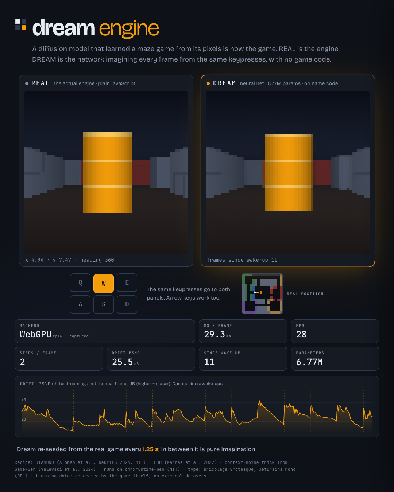
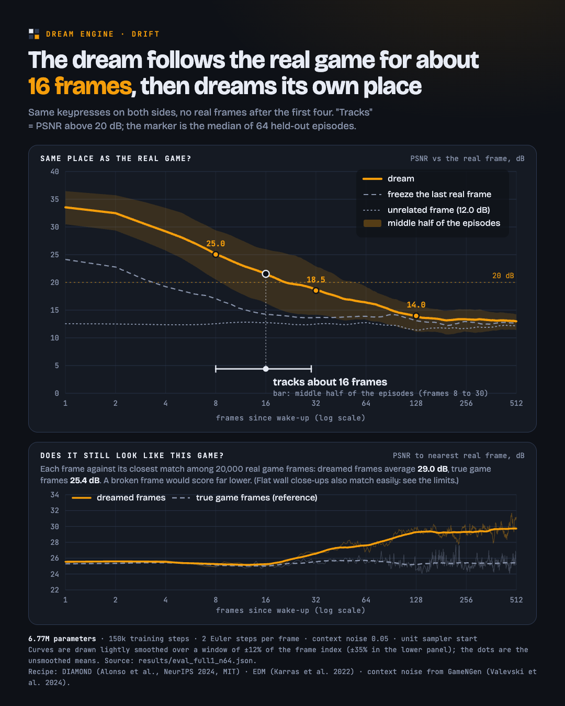
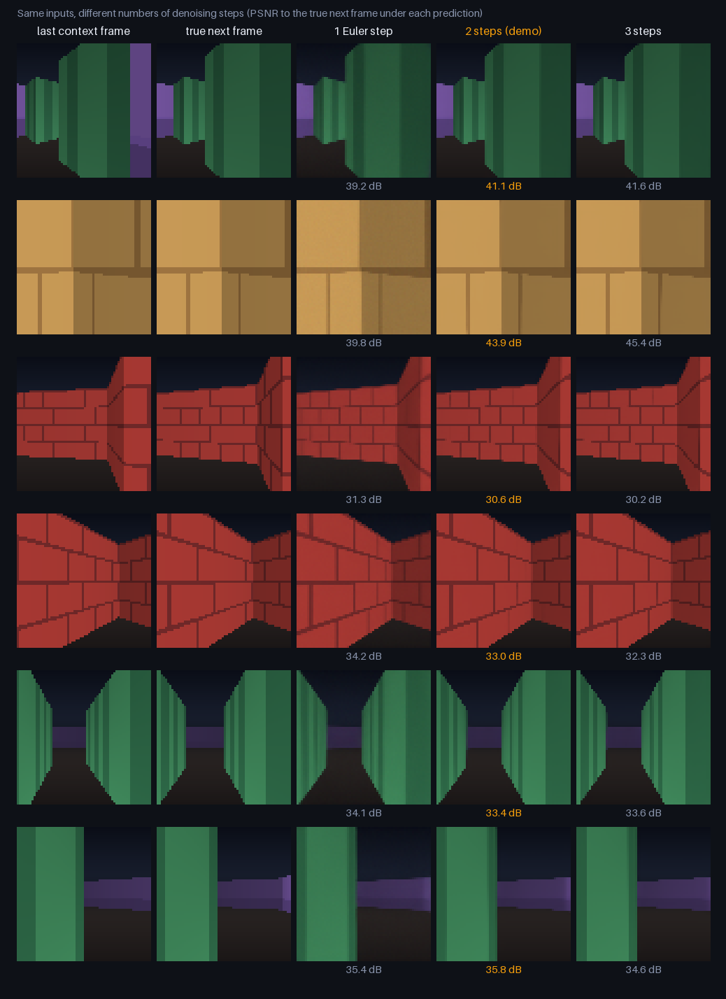
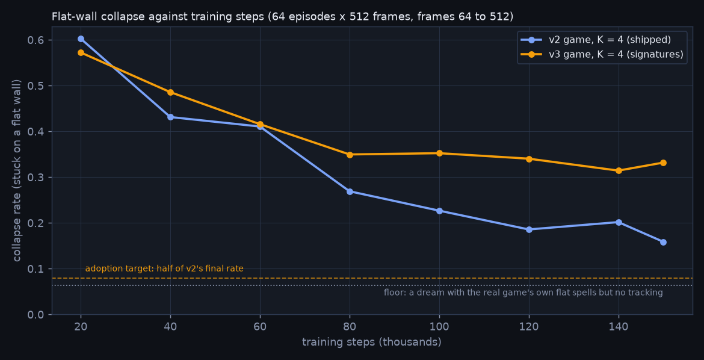

# Dream Engine

**Live demo: <https://dream.teshnizi.dev>** (Chrome or Edge 113+ for WebGPU; other browsers fall back to WASM, which is slower; the fp16 model is about 13 MB) · MIT licence

**A game that only exists in a neural network's dream.** A small diffusion world model, trained on a first-person
raycaster maze, runs in your browser tab and *is* the game: on the left the real engine, on the right the network
imagining every frame from the same keypresses, with no game code.



* Video (1080x1350, 22 s; 1080x1080 cut too): `media/dream-1080x1350.mp4`, `media/dream-1080x1080.mp4` · Hero still: `media/hero.png` · Drift figure: `media/drift.png` · Rollout grid and gif: `media/rollout_grid.png`, `media/rollout.gif` · Denoising steps: `media/sampler_steps.png`
* Run it: `cd site && python3 -m http.server 8000`, open <http://localhost:8000> in Chrome or Edge (WebGPU; falls back to WASM).
* Nothing here is deployed or posted. Everything below was measured; each number names the file it came from.

## At a glance

* **6.77M parameters**, trained for **150,000 steps (3.3 A100-hours)**; **28 frames per second** in a browser tab with the default 2 denoising steps (WebGPU, fp16, Apple M4 shared with other jobs; best window 29).
* One step ahead it is **34.0 dB** (copy-the-last-frame gets 23.9 dB). Left to dream, it **tracks the real game for about 16 frames** (median of 64 episodes, middle half 8 to 30 frames; PSNR above 20 dB, 5-frame average), then wanders into a different, still game-like place: **18.5 dB after 32 frames, 14.0 dB after 128** (an unrelated frame scores 12.0 dB).
* All 8 hold-one-key tests (move, strafe, turn and the arcs) beat "freeze the last frame" after 8 frames; the smallest margin is 4.9 dB (back). A full 360 degree spin does **not** return to the starting view (18.0 dB): no map memory.
* The biggest lesson: the bottleneck was the game, not the network (see "What was tried").
* A pre-registered attempt to fix the collapse onto flat wall views (v3: every wall face gets its own colour signature, plus a longer context) **did not meet its adoption rule**: collapse rate 0.33 against 0.16, median tracking horizon 19 against 20 frames (64 episodes x 512 frames, same protocol); v2 stays shipped and v3 is documented as a negative result (see "What was tried").

## What it is

| | |
|---|---|
| Game | deterministic Wolfenstein-style raycaster, 64x64 RGB, one fixed hand-designed 16x16 map with four landmarks (amber pillar, blue doorway, red-brick room, window gallery), continuous position and heading, 27 key combinations (move x strafe x turn) |
| Twins | the same game in Python (numpy, vectorised) and JavaScript, **100.0000% identical pixels, max abs diff 0** over 1112 frames (`results/game_parity.json`) |
| Model | DIAMOND-style EDM U-Net, **6.77M parameters** (widths 32-64-96-128, 2 residual blocks per level, attention in the 8x8 middle block), conditioned on the last 4 frames (channel concat) and the last 4 actions (adaptive GroupNorm); context-noise augmentation from GameNGen |
| Data | never stored: every training batch is generated on the fly by a sticky-random exploration policy (1699 frames/s per process; coverage entropy 0.995 of 1.0, no open cell without samples; `results/coverage.png`) |
| Training | ALICE (Leiden), one A100 per job, bf16, batch 128: **150,000 steps = 3.3 GPU-hours** for the main run (Slurm wall time, including the evaluation that closes the job), 12.9 GPU-hours in total including ablations, smoke tests and cancelled jobs (`RUNS.md`, `results/training_summary.json`) |
| Browser | onnxruntime-web 1.30.0, WebGPU with graph capture (fp16), WASM fallback; **20 fps with 3 denoising steps, 30 with 1** on an Apple M4 that was shared with other jobs (see "Speed") |

## Results

All results are on held-out data from the game's own exploration policy unless stated. Scripts: `eval.py`,
`tools/probe_sampler.py`, `tools/browser_fps.mjs`, `export.py`; raw numbers in `results/`.

### One-step prediction (the real last 4 frames + actions -> the next frame)

256 fixed validation windows, context noise 0.05, sampler start `unit`.

| method | PSNR dB | SSIM | model calls | browser ms/frame |
|---|---|---|---|---|
| copy the last frame (baseline) | 23.9 | 0.660 | 0 |  |
| Euler, 1 step | 33.7 | 0.935 | 1 | 23 ms |
| Euler, 2 steps | 34.0 | 0.936 | 2 | 29 ms |
| Euler, 3 steps (DIAMOND) | 33.8 | 0.934 | 3 | 46 ms |
| Heun, 2 steps (unstable here) | 5.7 | 0.026 | 3 |  |
| Heun, 3 steps (unstable here) | 16.4 | 0.463 | 5 |  |

Source: `results/eval_full1_n64.json`, `results/browser_fps.json`.

### Drift: pure imagination against the true game

Rollouts of 512 frames from 4 real frames, 64 episodes (exploration-policy actions), Euler 2 steps, init `unit`, context noise 0.05. An unrelated frame scores about 12.0 dB. The median episode falls below 20 dB at frame 16 (0.5 s at the demo's 30 game ticks per second); after that the dream wanders to a different place.

| frames since wake-up | 1 | 4 | 8 | 16 | 32 | 64 | 128 | 256 | 512 |
|---|---|---|---|---|---|---|---|---|---|
| dream (PSNR dB) | 35.1 | 29.2 | 25.0 | 21.7 | 18.5 | 16.2 | 14.0 | 13.3 | 12.8 |
| dream (SSIM) | 0.95 | 0.88 | 0.78 | 0.67 | 0.60 | 0.53 | 0.49 | 0.47 | 0.47 |
| freeze the last real frame (PSNR dB) | 25.9 | 19.1 | 17.8 | 14.2 | 13.7 | 14.1 | 13.5 | 12.9 | 12.5 |

* tracking horizon per episode (first frame whose 5-frame average PSNR is below the threshold): **median 16 frames below 20 dB** (middle half 8 to 30; 0% of the 64 episodes never fall below within 512 frames) and median 7 frames below 25 dB (middle half 4 to 14); the mean curve crosses 20 dB at frame 21, pulled up by easy episodes; frames 129-512 average 13.2 dB, close to the 12.0 dB of an unrelated frame (so past that point it is a different place, not a worse copy)
* late frames keep **47%** of the real frames' edge sharpness (mean gradient magnitude, last 32 frames; 100% = as sharp as the real game)
* hold *turn right* for a full 360 degrees (72 frames): the real game ends on exactly the start view (100 dB), the dream's frame 72 matches the start view at only **18.0 dB** (it has no map memory to close the loop)



### Is it still a game frame?

PSNR of every dreamed frame to its nearest neighbour among a bank of real frames, averaged over the rollout: **29.0 dB** for dream frames against **25.4 dB** for the true frames of the same episodes. High values late in the rollout mean the dream settles on simple, game-like views (often a wall close-up): it stays valid but loses detail (`sharpness_ratio_last32` in the probe json). Source: `results/eval_full1_n64.json`.

### Do the controls work? (hold one key for 24 frames from random poses)

| key | dream @8 frames | freeze @8 | dream @24 | freeze @24 |
|---|---|---|---|---|
| forward | 26.8 | 18.7 | 21.9 | 16.5 |
| back | 22.9 | 18.0 | 19.1 | 15.6 |
| turn left | 24.8 | 15.1 | 18.1 | 13.6 |
| turn right | 24.6 | 16.3 | 17.4 | 13.7 |
| strafe left | 23.3 | 18.1 | 19.4 | 16.4 |
| strafe right | 22.9 | 17.8 | 18.5 | 16.2 |
| forward+left | 23.3 | 15.3 | 17.7 | 14.1 |
| forward+right | 26.4 | 16.9 | 18.9 | 14.0 |

PSNR dB against the real game; "freeze" repeats the last real frame. Every key beats freezing at 8 frames; the smallest margin is 4.9 dB (back). Strafing is the rarest action in the training data.

### Sampler and context-noise settings

12 inference settings (1-3 Euler steps, two initialisations, context noise 0 or 0.1) over 16 episodes x 128 frames: mean PSNR over the first 32 frames ranges from 21.9 to 23.7 dB, so the setting matters little; the best was 1 step, init `unit`, context noise 0.0. The demo runs 2 steps, init `unit`, context noise 0.05 (between the probed 0 and 0.1): the neighbouring probed settings score 23.4 and 23.1 dB, within the noise of the best, while one step ahead 2 steps score 34.0 dB against 33.7 for 1 step, and 2-step frames are visibly cleaner (see below). Source: `results/probe_full1_a100.json`.

### Smoke tests before the main run

| run | steps | training loss | time | one-step PSNR / SSIM (3 Euler steps, 128 windows) |
|---|---|---|---|---|
| local Apple M4 (MPS), GPU shared | 275 | 1.10 -> 0.224 | 10.2 min (0.4 it/s) | 19.4 dB / 0.21 |
| ALICE A100 (job 5246018) | 3000 | 0.75 -> 0.029 | 4.5 min (12.2 it/s) | 24.9 dB / 0.73 |

The local run stopped early because the Mac's GPU was shared with other jobs (about 0.35 it/s); the ALICE smoke job is the evidence that the pipeline learns (its copy-last-frame baseline is quoted in RUNS.md row 1). Sources: `results/*_smoke_metrics.jsonl`, RUNS.md row 1.

### How stable are these numbers? (one checkpoint, five evaluations)

| evaluation | episodes x frames | 1-step PSNR dB | mean PSNR, first 32 frames (± s.e.) | mean PSNR, first 128 | median episode: frames until < 20 dB | mean curve: frames until < 20 dB | nearest-real-frame PSNR (real) |
|---|---|---|---|---|---|---|---|
| A100, closing eval of the training job | 8 x 256 | 34.0 | 22.0 | 17.7 | n/a | 16 | 28.8 (24.2) |
| A100, `eval_many` | 16 x 256 | 34.0 | 24.5 | 18.0 | n/a | 37 | 27.8 (24.4) |
| A100 | 16 x 512 | 34.0 | 24.5 | 18.0 | n/a | 37 | 28.4 (24.8) |
| Apple M4 (MPS) | 8 x 512 | 34.0 | 22.0 | 17.0 | n/a | 18 | 30.7 (24.5) |
| A100, **primary** | 64 x 512 | 34.0 | 22.8 ± 0.6 | 17.5 | 16 | 21 | 29.0 (25.4) |

The one-step score does not move with the sample or the hardware. The drift statistics do: the mean over the first 32 frames ranges from 22.0 to 24.5 dB across episode samples (the 64-episode standard error is shown), and the mean curve's crossing of 20 dB is unstable because a few easy episodes pull it up, so the headline tracking horizon is the median over episodes. Different hardware draws different noise. Comparisons in "What was tried" are made only within one episode sample.

### What the denoising steps change



6 evenly spaced validation windows (picked by position, not by quality), same noise seed. Mean PSNR to the true next frame: **35.6 dB** with 1 Euler step, **36.3** with 2, **36.3** with 3. One step leaves visible grain on flat surfaces (second row); two steps are as clean as three, so the demo defaults to 2. In the browser they cost 23 / 29 / 46 ms per frame (median windows). Source: `results/sampler_figure.json` (`tools/sampler_figure.py`).

### ONNX export (opset 17, batch 1, static shapes) against PyTorch

| precision | size MB | max abs diff, ONNX Runtime CPU | max abs diff, WebGPU in the browser |
|---|---|---|---|
| fp32 | 27.3 | 5.2e-06 | 3.0e-06 |
| fp16 | 13.8 | 4.8e-03 | 1.2e-02 |

Outputs are in [-1, 1]; 1 grey level = 0.0078. Sources: `results/onnx_export_dream.json`, `results/onnx_browser_verification.json`.

### The whole browser pipeline against Python (same 64 windows)

The JavaScript game renders the windows, the JavaScript sampler and onnxruntime-web (WebGPU) predict the next frame; Python does the same with PyTorch (mean of 3 noise seeds). Copy-last-frame on these windows: 25.21 dB, context noise 0.05, init `unit`.

| Euler steps | PyTorch PSNR dB | browser fp32 PSNR dB | browser fp16 PSNR dB |
|---|---|---|---|
| 1 | 34.15 | 34.16 | 34.15 |
| 2 | 34.53 | 34.46 | 34.44 |
| 3 | 34.33 | 34.16 | 34.14 |

Source: `results/browser_vs_python_1step.json` (`tools/crosscheck.py`). Different noise draws, so agreement within a few tenths of a dB is expected.

### Speed in the browser (Apple M4, headless Edge, WebGPU fp16 with graph capture)

| denoising steps | ms per frame, median window | fps, median window | ms per frame, best window | fps, best window | GPU busy with other jobs just before the windows (%) | windows |
|---|---|---|---|---|---|---|
| 1 | 23.4 | 30 | 17.2 | 30 | 24-44 | 4 |
| 2 | 29.3 | 28 | 28.5 | 29 | 27-30 | 4 |
| 3 | 46.0 | 20 | 35.4 | 23 | 30-41 | 4 |

The game tick is capped at 30 per second, so the best windows read 30 fps. **The M4's GPU was shared with other jobs on this machine during all runs** (the busy column: `ioreg` utilisation sampled with this page paused), which is why the median windows are slower than the best ones; a quiet GPU should behave like the best windows. Source: `results/browser_fps.json` (`tools/browser_fps.mjs`).

## What was tried (and what did not help)

#### Architecture and context noise (game v1, 20k steps each)

| variant | params | 1-step PSNR dB | SSIM | rollout PSNR @32 frames | copy-last baseline |
|---|---|---|---|---|---|
| widths 32-64-96-128, 2 blocks (used) | 6.77M | 27.9 | 0.835 | 16.7 | 22.2 |
| same, no context noise | 6.77M | 27.6 | 0.831 | 17.1 | 22.2 |
| widths 64x4, 2 blocks (DIAMOND size) | 4.47M | 28.0 | 0.843 | 17.9 | 22.2 |
| widths 32-64-96-128, 1 block | 4.51M | 27.7 | 0.824 | 18.3 | 22.2 |

The 4 variants span 0.4 dB in 1-step PSNR: width, depth and context noise were not the bottleneck. (Evaluated at the time with 1 Euler step, `edm` start, context noise 0.1.)

#### The game, not the network, was the ceiling

| game version (same model and recipe, 20k steps) | 1-step PSNR dB | copy-last baseline dB | share of squared error on window-pane pixels |
|---|---|---|---|
| v1: fine textures | 27.9 | 22.2 | 58% (5% of pixels) |
| v2: distance pre-filtered, wide window panes | 30.7 | 23.9 | 36% (5% of pixels) |

Window stripes were 5% of the pixels but 58% of the model's squared error; redesigning them (3 panes per wall, fading to their mean colour with distance) cut that share to 36%. For the final model the window panes are still 5% of the pixels and 33% of the error, and strong vertical edges (window frames, brick joints, wall corners) are 14% of the pixels and 73% of the squared error: thin high-contrast structure is where the model is least exact. Source: `results/error_attribution_*.json` (`tools/error_attribution.py`).

#### Does more training help? (same model and recipe, game v2)

Same evaluation code and demo sampler (2 Euler steps, `unit` start, context noise 0.05), the same 16 episodes x 256 frames for both, one run each.

| run | steps | 1-step PSNR dB | mean PSNR, first 32 frames | mean PSNR, first 128 | frames until < 20 dB | late-frame sharpness vs real | nearest-real-frame PSNR (real frames) | 360 degree spin, return PSNR dB |
|---|---|---|---|---|---|---|---|---|
| w2_B | 20,000 | 31.5 | 21.2 | 16.6 | 14 (mean curve) | 0.22 | 29.6 (24.4) | 15.8 |
| full1 (the demo's model) | 150,000 | 34.0 | 24.5 | 18.0 | 37 (mean curve) | 0.47 | 27.8 (24.4) | 18.0 |

7.5x the training steps buy +2.5 dB one step ahead and +3.3 dB over the first 32 rollout frames. This 16-episode sample is an easier one for the final model (24.5 dB over the first 32 frames against 22.8 on the 64-episode primary sample), so compare the two rows with each other, not with the headline numbers.

#### Can training fix drift? (4k-step fine-tunes of the 20k-step model, game v2)

Every row evaluated with the same code and the demo's sampler (2 Euler steps, `unit` start, context noise 0.05), 16 episodes x 256 frames.

| fine-tune | 1-step PSNR dB | mean PSNR over the first 32 rollout frames | nearest-real-frame PSNR (real frames) | late-frame sharpness vs real |
|---|---|---|---|---|
| plain fine-tune (control) | 31.6 | 21.8 | 29.9 (24.4) | 0.22 |
| DIAMOND-style unroll 3 | 31.8 | 21.6 | 29.9 (24.4) | 0.19 |
| context blur augmentation | 31.6 | 21.5 | 29.8 (24.4) | 0.21 |
| scheduled sampling, 3 own frames, p 0.5 | 30.9 | 21.5 | 30.8 (24.4) | 0.13 |

Change in the mean PSNR over the first 32 frames against the plain control: DIAMOND-style unroll 3 -0.2 dB, context blur augmentation -0.2 dB, scheduled sampling, 3 own frames, p 0.5 -0.2 dB. None of them beats the control by more than the run-to-run noise (about 0.4 dB: the plain control itself moved the means by that much). Context blur: nearest-real-frame PSNR 29.8 dB against 29.9 for the control (true frames: 24.4). Scheduled sampling changes the 1-step PSNR by -0.8 dB.

#### v3: can the flat-wall collapse be fixed? (pre-registered: `docs/PREREG-v3.md`)


Long dreams collapse onto flat wall views and stay there. The hypothesis was observability: with 4 context frames a close-up wall carries no information about where the player is (walls of one colour region are identical, and so are N and S faces), so once the context is all wall the model has nothing to localise from. **Game v3** gives every wall face its own low-frequency colour signature (a smooth tint of the hit position, 12 grey levels, periods of at least 5 cells) and four distinct face shades, keeping the map, physics, floor, ceiling, fog and landmarks; the JavaScript twin stays bit-exact with the Python reference. The second change was a longer context, K = 8 against K = 4.

A model-free check on rendered frames (nearest-neighbour pose recovery from flat-wall views with noise, `results/observability_v2_v3.json`): the recovered position is within 1.5 cells 46% of the time in v2 and 91% in v3, the heading within 45 degrees 71% and 96%. The information is in the v3 frames; whether a trained network uses it is what was tested. The 142 visible wall faces are at least 3.9 grey levels apart (`results/signature_design_v3.json`).

**Metrics, fixed before any v3 model existed.** Every model wakes up at the same real frame (the 8th) on the same 64 episodes and dreams 512 frames with the demo's sampler. *Tracking horizon*: the first frame whose 5-frame average PSNR is below 20 dB, median over episodes. *Collapse rate*: the fraction of dream frames at 64 to 512 that are *stuck on a flat wall* (at most 5% floor or ceiling pixels in each of the last 32 frames) while the matching real frame is not; the real game itself is flat-wall in about a quarter of its frames, which is why the metric asks the dream to stay there (window and thresholds were fixed on v2 rollouts, `docs/PREREG-v3.md` section 4). *Spin return*: PSNR between the start view and the view after a full 360 degree turn.

**20k-step ablation** (same recipe as `w2_B`, one run each, 64 episodes x 512 frames):

| run | game | K | steps | median frames until < 20 dB (middle half) | collapse rate (95% interval) | single-frame collapse rate | flat-wall share dream / real | 360 degree spin return, dB | 1-step PSNR dB (copy-last) | mean PSNR, first 32 frames | collapse rate relative to the baseline (paired 95% interval) |
|---|---|---|---|---|---|---|---|---|---|---|---|
| w2_B (baseline) | v2 | 4 | 20,000 | 14 (5.8 to 25.5) | 0.667 (0.61 to 0.72) | 0.620 | 0.84 / 0.25 | 15.1 | 31.4 (24.2) | 21.2 | 1 |
| v2k8 | v2 | 8 | 20,000 | 13.5 (5 to 23.5) | 0.670 (0.61 to 0.73) | 0.616 | 0.83 / 0.25 | 15.3 | 31.4 (24.2) | 21.0 | 1.00 (0.92 to 1.09) |
| v3k4 | v3 | 4 | 20,000 | 15.5 (7 to 27) | 0.542 (0.48 to 0.61) | 0.554 | 0.76 / 0.25 | 15.2 | 31.8 (24.7) | 21.7 | 0.81 (0.72 to 0.90) |
| v3k8 | v3 | 8 | 20,000 | 13 (7 to 28.2) | 0.498 (0.43 to 0.57) | 0.511 | 0.71 / 0.25 | 14.8 | 31.8 (24.7) | 21.5 | 0.75 (0.65 to 0.85) |

Selection rule (fixed in advance): 1 of 3 variants have a median horizon of at least the baseline's (14.0); collapse rates within 0.02 of the lowest (0.542): ['v3k4']; chosen: v3k4.

**Full run and the adoption rule** (150,000 steps, the recipe of `full1`; both evaluated with the same code on the same 64 episodes):

| run | game | K | steps | median frames until < 20 dB (middle half) | collapse rate (95% interval) | single-frame collapse rate | flat-wall share dream / real | 360 degree spin return, dB | 1-step PSNR dB (copy-last) | mean PSNR, first 32 frames |
|---|---|---|---|---|---|---|---|---|---|---|
| full1 (v2, shipped before) | v2 | 4 | 150,000 | 20 (10.5 to 33) | 0.159 (0.13 to 0.20) | 0.346 | 0.49 / 0.25 | 15.0 | 34.1 (24.2) | 23.3 |
| full2 | v3 | 4 | 150,000 | 19 (10.8 to 38) | 0.332 (0.27 to 0.40) | 0.429 | 0.60 / 0.25 | 15.5 | 34.4 (24.7) | 24.0 |

The rule: adopt only if the collapse rate is at most half of full1's **and** the median tracking horizon is not shorter. Collapse rate 0.332 against 0.159 (ratio 2.09, paired 95% interval 1.72 to 2.56): not met. Median horizon 19 against 20 frames (difference -1, paired 95% interval -4 to +5): not met.

**v3 did not meet the pre-registered rule (the collapse rate was not at most half and the tracking horizon got shorter), so v2 stays shipped.** This is a negative result for the observability fix as tried here (one training run per variant, this signature design, this budget); the code, the game and all the numbers above are in the repository. PSNR levels are not comparable across the two games (copy-last-frame baseline 24.2 dB in v2 and 24.7 dB in v3; unrelated-frame floor 12.5 and 12.8 dB).

Sources: `results/prereg_*.json` (`eval_prereg.py`), `results/prereg_ablation.json` and `results/prereg_final_full2_vs_full1.json` (`tools/compare_prereg.py`); RUNS.md.

**Exploratory: how long does the dream stay on a flat wall?** From the saved per-frame arrays, frames 64 to 512 (a flat spell is a run of frames with at most 5% floor or ceiling pixels):

|  | share of frames flat | median spell (frames) | longest spell | chance of leaving a flat wall in a given frame |
|---|---|---|---|---|
| real game | 0.25 | 9 | 282 | 6.30% |
| w2_B | 0.84 | 99 | 449 | 0.46% |
| v2k8 | 0.83 | 83 | 449 | 0.47% |
| v3k4 | 0.76 | 35 | 449 | 0.98% |
| v3k8 | 0.71 | 25 | 449 | 1.00% |
| full1 | 0.49 | 18 | 449 | 3.26% |
| full2 | 0.60 | 18 | 449 | 1.99% |

The collapse is mostly a failure to leave: the real game leaves a flat wall in about 1 frame in 16, the dream far less often, and training makes the biggest difference. Source: `results/flat_spells.json` (`tools/flat_spells.py`).

**Exploratory: the learning curve of the collapse.** Collapse rate / median tracking horizon of the EMA checkpoints saved every 20k steps (same protocol, 64 episodes x 512 frames):

| training steps | v2 (`full1`) | v3 (`full2`) |
|---|---|---|
| 20,000 | 0.602 / 15 | 0.572 / 12.5 |
| 40,000 | 0.431 / 14 | 0.486 / 16 |
| 60,000 | 0.411 / 14 | 0.416 / 17.5 |
| 80,000 | 0.269 / 14.5 | 0.349 / 18.5 |
| 100,000 | 0.227 / 16 | 0.352 / 20 |
| 120,000 | 0.186 / 16 | 0.340 / 19 |
| 140,000 | 0.202 / 16.5 | 0.314 / 19.5 |
| 150,000 | 0.159 / 20 | 0.332 / 19 |



The collapse rate falls with training in v2, so a 20k-step comparison says little about 150k steps and has to be read against v2 at the same step. Source: `results/prereg_<run>_s<step>.json` (`tools/render_collapse_curve.py`).

**Exploratory: does a v3 model read the signature?** The flat-wall escape test is run in the v3 game and in a copy whose tint is shifted (a different position code on the same geometry); a model that only copies colours scores the same in both, one that reads the code as a position is misled and loses PSNR:

| checkpoint | training steps | PSNR @8, true signature | PSNR @8, shifted signature | drop @8, dB | mean drop over 24 frames, dB |
|---|---|---|---|---|---|
| full2_s20000 | 20,000 | 22.2 | 22.1 | 0.14 | 0.13 |
| v3k4 | 20,000 | 23.0 | 22.6 | 0.38 | 0.38 |
| full2_s40000 | 40,000 | 23.4 | 23.2 | 0.21 | 0.16 |
| full2_s60000 | 60,000 | 23.8 | 23.5 | 0.24 | 0.23 |
| full2_s80000 | 80,000 | 24.2 | 23.6 | 0.59 | 0.46 |
| full2_s100000 | 100,000 | 24.4 | 23.8 | 0.58 | 0.50 |
| full2_s120000 | 120,000 | 24.5 | 23.5 | 0.99 | 0.71 |
| full2_s140000 | 140,000 | 25.0 | 23.8 | 1.21 | 0.76 |
| full2 | 150,000 | 24.9 | 23.8 | 1.08 | 0.85 |

Source: `results/signature_use_<run>.json` (`tools/signature_use.py`).

**Exploratory: flat-wall escape.** Start facing a wall closely with identical context frames and hold *turn right* for 24 frames; the real game turns away and shows what is around the corner. PSNR against the real game, and the share of dreams still on a flat wall at frame 24 (dream / real):

| model | PSNR @8 | @16 | @24 | still flat at frame 24 |
|---|---|---|---|---|
| w2_B (v2, 20k) | 22.4 | 16.8 | 15.6 | 41% / 17% |
| v3k4 (v3, 20k) | 23.0 | 17.0 | 15.4 | 41% / 17% |
| full1 (v2, 150k) | 24.4 | 18.0 | 16.4 | 22% / 17% |
| full2 (v3, 150k) | 24.8 | 18.8 | 16.9 | 23% / 17% |

**What this does and does not show.** At 20k steps the v3 game with K = 4 had lowered the collapse rate to 0.81 of the v2 baseline (paired 95% interval 0.72 to 0.90); at 150k it is 2.09 times v2's (paired interval 1.72 to 2.56). The v3 model does read the signature: shifting it costs 0.85 dB on average in the escape test at 150,000 steps, up from 0.13 dB at 20,000. A longer context on the unchanged game did nothing (ablation row `v2k8`). So with this design and budget the colour signature was used and did not stop the dream from collapsing onto flat walls; the data do not support "a close-up wall carries no information about where you are" as the (only) cause. They do not show that v3 *causes* more collapse, or that no other signature design would help: every row is a single training run, the intervals above cover the sampling of episodes but not the variation between training runs (the sign of the effect changed between 20k and 150k steps), and the collapse rate of v2 itself moves by several points between neighbouring checkpoints.  The one thing v3 seems to improve is tracking: the median tracking horizon of the v3 checkpoints is at least v2's at 6 of 7 milestones (from 40,000 steps on; the final models: 19 against 20 frames), and the mean PSNR over the first 32 frames of the final models is 24.0 against 23.3 dB (different games, so an observation, not a like-for-like comparison).

## How to run

```bash
# the demo (any static server works; WebGPU needs Chrome/Edge 113+, otherwise it runs on WASM at 7.2 fps (132 ms per frame, 2 steps, fp32, in a worker; results/browser_fps_wasm.json))
cd site && python3 -m http.server 8000

# tests: 60+ python tests (game, data, model, sampler, export, training) and the JS twin / helpers
uv venv --python 3.12 .venv && uv pip install --python .venv/bin/python -r requirements.txt
.venv/bin/python tests/make_parity_fixture.py && .venv/bin/python -m pytest tests -q && node --test tests/*.test.mjs
npm install && npm run smoke                       # end-to-end browser smoke test (headless Edge, WebGPU)

# train (local smoke on Apple MPS, or ALICE): see alice/ for the cluster scripts
.venv/bin/python train.py --out runs/smoke --steps 1200 --batch 32 --device mps --time-limit-min 18
.venv/bin/python eval.py --ckpt runs/full1/final_ema.pt --name full1
.venv/bin/python eval_prereg.py --ckpt runs/full1/final_ema.pt --name full1       # the pre-registered v3 metrics (64 episodes x 512 frames)
.venv/bin/python export.py --ckpt runs/full1/final_ema.pt --out site/models --name dream --fp16 --verify
```

URL options: `?steps=1|2|3`, `?backend=wasm`, `?dtype=fp32`, `?capture=1` (deterministic poster layout used for the video).
Keys: WASD / arrows move and turn, Q/E strafe, R wake up, T dream only, P pause, 1-3 denoising steps.

## Honest limits

* **One fixed map, 64x64 pixels.** Training and evaluation use the same maze and the same textures. Nothing was tested on other levels, so nothing here says the model generalises to them, and it is not a general game engine.
* **It drifts.** Errors compound frame after frame: the dream tracks the real game (PSNR above 20 dB) for about the first 16 frames and then goes to a different place. It stays *game-like* (see the validity table) but is no longer the same place as the real panel, so "PSNR against the real game" stops being meaningful after that point. "Wake up" re-seeds it from the real game, and the page marks every wake-up on the drift chart.
* **Long dreams collapse onto flat wall views (not fixed).** In 19% of frames 64 to 512 of a long dream the shipped model is stuck on a flat wall (no floor or ceiling for 32 frames in a row), against 7% for the real game's own path; the collapsed frames are smooth colour fields with far less structure than a real wall close-up. A pre-registered fix (v3: unique colour signatures on every wall face) did not meet its rule (collapse rate 0.33 against 0.16), so v2 stays shipped; a full 360 degree spin does not return to the start view either.
* **It gets smoother over time.** Late in a long rollout the dreamed frames lose detail and settle on simple views (often a wall close-up): over the last 32 frames of the 512-frame rollouts they keep 47% of the real frames' edge sharpness. Edges are always softer than the real engine's pixel-exact ones, and thin features (window frames, brick joints, the rings on the pillar) are the first to blur.
* **Human play was not tested.** Training data is a sticky random walk with wall avoidance, not human play. Strafing (Q/E) is the rarest action, and backing up and strafing are among the lowest-scoring controls in the hold-one-key test; spinning in place or pressing into walls for a long time is further from the training distribution.
* **Small, single-run evidence.** One architecture trained at one scale; every comparison is a single run per setting, and differences below about 0.5 dB are within run-to-run noise (an extra 4k plain fine-tuning steps moved the rollout means by 0.4 dB), and the drift numbers depend on which episodes are drawn ("How stable are these numbers?"). Evaluation is on the game's own trajectories; there is no human study of how convincing it feels.
* **Speed is hardware-dependent.** The fps numbers are from one Apple M4 whose GPU was shared with other jobs, in headless Edge. Other GPUs, browsers and power states differ. Without WebGPU the page falls back to WASM: 7.2 fps (132 ms per frame, 2 steps, fp32, in a worker; results/browser_fps_wasm.json).
* **Toy scale on purpose.** GameNGen fine-tunes a Stable Diffusion model and Genie is trained on internet video at far larger scale; this is a few million parameters, hours of A100 time, one map. It shows the recipe, not the state of the art.
* **Heun is not a verdict on Heun.** With two or three Heun steps and the sigma range 2e-3 to 5 the sampler diverged here (5.7 and 16.4 dB one step ahead against 34.0 for Euler), so Euler steps (as in DIAMOND) are used; more steps or a different schedule would likely work.

## Repo map

```
game/        raycaster.py (reference), raycaster.mjs (JS twin), spec.json (the shipped game: map, physics, palette), spec_v2.json / spec_v3.json (the two frozen game versions)
data/        exploration policy, on-the-fly trajectory generator, coverage heatmap
model/       U-Net (DIAMOND blocks), EDM denoiser with context noise / unrolled / blur augmentation, samplers, metrics, flatwall.py (the flat-wall metric)
train.py     resumable training (EMA, bf16, signals, time limit)      eval.py   drift / validity / control evaluation
eval_prereg.py  the pre-registered v3 evaluation (docs/PREREG-v3.md)  export.py ONNX export (static, opset 17) + fp16 + numeric checks
alice/       setup.sh, train.slurm, submit_chain.sh, probe.slurm, prereg_many.slurm
site/        the static demo (index.html, js/, models/)               tools/    benchmarks, capture, figures, smoke test, probes, v3 design and comparison tools
tests/       python + node tests (TDD)                                results/  every number quoted here, as json (+ figures)
docs/        limits.md, PREREG-v3.md                                  RUNS.md   one row per ALICE experiment
STATE.md     handoff note                                             POST.md   LinkedIn draft (never posted)
```

## Credits and licences

* **DIAMOND** (Alonso, Jelley, Micheli, Kanervisto, Storkey, Pearce, Fleuret, NeurIPS 2024; MIT): U-Net blocks, EDM
  preconditioning and the 3-step Euler sampler are re-implemented from `eloialonso/diamond` (read in `vendor/`).
* **EDM** (Karras, Aittala, Aila, Laine 2022); **GameNGen** (Valevski, Leviathan, Arar, Fruchter 2024), context-noise augmentation.
* **onnxruntime-web** 1.30.0 (Microsoft, MIT). Fonts: Bricolage Grotesque and JetBrains Mono (SIL OFL), via Google Fonts.
* No external datasets: the data is generated by the game in this repository. Full third-party notices: `THIRD_PARTY.md`. This repository's own code, and the trained weights shipped in `site/models/`, are released under the MIT licence (`LICENSE`).
