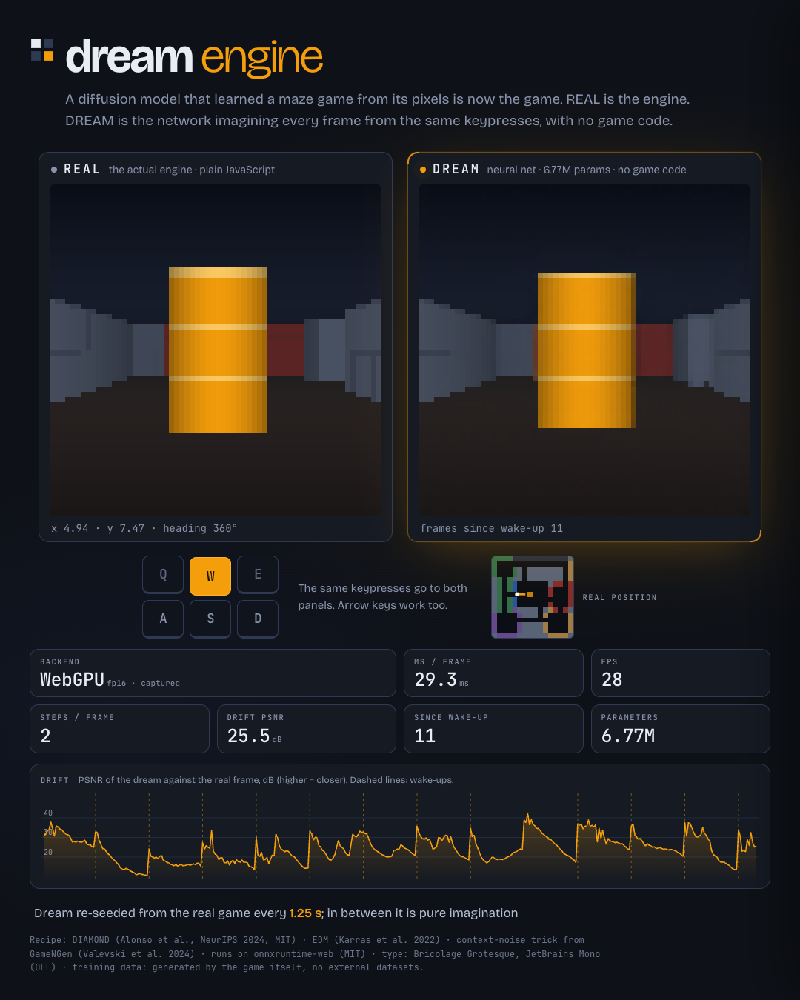

# Dream Engine

**A game that only exists in a neural network's dream.** A small diffusion world model, trained on a first-person
raycaster maze, runs in your browser tab and *is* the game: on the left the real engine, on the right the network
imagining every frame from the same keypresses, with no game code.



* Video (1080x1350, 22 s; 1080x1080 cut too): `media/dream-1080x1350.mp4`, `media/dream-1080x1080.mp4` · Hero still: `media/hero.png` · Drift figure: `media/drift.png` · Rollout grid and gif: `media/rollout_grid.png`, `media/rollout.gif` · Denoising steps: `media/sampler_steps.png`
* Run it: `cd site && python3 -m http.server 8000`, open <http://localhost:8000> in Chrome or Edge (WebGPU; falls back to WASM).
* Nothing here is deployed or posted. Everything below was measured; each number names the file it came from.

## At a glance

* **@@PARAMS_M@@M parameters**, trained for **@@MAIN_STEPS@@ steps (@@MAIN_HOURS@@ A100-hours)**; **@@FPS2@@ frames per second** in a browser tab with the default 2 denoising steps (WebGPU, fp16, Apple M4 shared with other jobs; best window @@FPS2_BEST@@).
* One step ahead it is **@@ONE_STEP_PSNR@@ dB** (copy-the-last-frame gets @@COPY_PSNR@@ dB). Left to dream, it **tracks the real game for about @@TRACK20@@ frames** (@@TRACK20_NOTE@@), then wanders into a different, still game-like place: **@@ROLL_PSNR_32@@ dB after 32 frames, @@ROLL_PSNR_128@@ dB after 128** (an unrelated frame scores @@FLOOR_PSNR@@ dB).
* @@CONTROLS@@ A full 360 degree spin does **not** return to the starting view (@@SPIN_BACK@@ dB): no map memory.
* The biggest lesson: the bottleneck was the game, not the network (see "What was tried").
@@V3_GLANCE@@

## What it is

| | |
|---|---|
| Game | deterministic Wolfenstein-style raycaster, 64x64 RGB, one fixed hand-designed 16x16 map with four landmarks (amber pillar, blue doorway, red-brick room, window gallery), continuous position and heading, 27 key combinations (move x strafe x turn) |
| Twins | the same game in Python (numpy, vectorised) and JavaScript, **@@PARITY_PCT@@% identical pixels, max abs diff @@PARITY_MAXDIFF@@** over @@PARITY_FRAMES@@ frames (`results/game_parity.json`) |
| Model | DIAMOND-style EDM U-Net, **@@PARAMS_M@@M parameters** (widths 32-64-96-128, 2 residual blocks per level, attention in the 8x8 middle block), conditioned on the last 4 frames (channel concat) and the last 4 actions (adaptive GroupNorm); context-noise augmentation from GameNGen |
| Data | never stored: every training batch is generated on the fly by a sticky-random exploration policy (@@DATA_FPS@@ frames/s per process; coverage entropy @@COVERAGE@@ of 1.0, no open cell without samples; `results/coverage.png`) |
| Training | ALICE (Leiden), one A100 per job, bf16, batch 128: **@@MAIN_STEPS@@ steps = @@MAIN_HOURS@@ GPU-hours** for the main run (Slurm wall time, including the evaluation that closes the job), @@TOTAL_GPUH@@ GPU-hours in total including ablations, smoke tests and cancelled jobs (`RUNS.md`, `results/training_summary.json`) |
| Browser | onnxruntime-web 1.30.0, WebGPU with graph capture (fp16), WASM fallback; **@@FPS3@@ fps with 3 denoising steps, @@FPS1@@ with 1** on an Apple M4 that was shared with other jobs (see "Speed") |

## Results

All results are on held-out data from the game's own exploration policy unless stated. Scripts: `eval.py`,
`tools/probe_sampler.py`, `tools/browser_fps.mjs`, `export.py`; raw numbers in `results/`.

@@RESULTS_TABLES@@

## What was tried (and what did not help)

@@ABLATIONS@@

## How to run

```bash
# the demo (any static server works; WebGPU needs Chrome/Edge 113+, otherwise it runs on WASM at @@WASM_FPS@@)
cd site && python3 -m http.server 8000

# tests: 60+ python tests (game, data, model, sampler, export, training) and the JS twin / helpers
uv venv --python 3.12 .venv && uv pip install --python .venv/bin/python -r requirements.txt
.venv/bin/python tests/make_parity_fixture.py && .venv/bin/python -m pytest tests -q && node --test tests/*.test.mjs
npm install && npm run smoke                       # end-to-end browser smoke test (headless Edge, WebGPU)

# train (local smoke on Apple MPS, or ALICE): see alice/ for the cluster scripts
.venv/bin/python train.py --out runs/smoke --steps 1200 --batch 32 --device mps --time-limit-min 18
.venv/bin/python eval.py --ckpt runs/full1/final_ema.pt --name full1
.venv/bin/python eval_prereg.py --ckpt runs/full1/final_ema.pt --name full1       # the pre-registered v3 metrics (64 episodes x 512 frames)
.venv/bin/python export.py --ckpt runs/full1/final_ema.pt --out site/models --name dream --fp16 --verify
```

URL options: `?steps=1|2|3`, `?backend=wasm`, `?dtype=fp32`, `?capture=1` (deterministic poster layout used for the video).
Keys: WASD / arrows move and turn, Q/E strafe, R wake up, T dream only, P pause, 1-3 denoising steps.

## Honest limits

@@LIMITS@@

## Repo map

```
game/        raycaster.py (reference), raycaster.mjs (JS twin), spec.json (the shipped game: map, physics, palette), spec_v2.json / spec_v3.json (the two frozen game versions)
data/        exploration policy, on-the-fly trajectory generator, coverage heatmap
model/       U-Net (DIAMOND blocks), EDM denoiser with context noise / unrolled / blur augmentation, samplers, metrics, flatwall.py (the flat-wall metric)
train.py     resumable training (EMA, bf16, signals, time limit)      eval.py   drift / validity / control evaluation
eval_prereg.py  the pre-registered v3 evaluation (docs/PREREG-v3.md)  export.py ONNX export (static, opset 17) + fp16 + numeric checks
alice/       setup.sh, train.slurm, submit_chain.sh, probe.slurm, prereg_many.slurm
site/        the static demo (index.html, js/, models/)               tools/    benchmarks, capture, figures, smoke test, probes, v3 design and comparison tools
tests/       python + node tests (TDD)                                results/  every number quoted here, as json (+ figures)
docs/        limits.md, PREREG-v3.md                                  RUNS.md   one row per ALICE experiment
STATE.md     handoff note                                             POST.md   LinkedIn draft (never posted)
```

## Credits and licences

* **DIAMOND** (Alonso, Jelley, Micheli, Kanervisto, Storkey, Pearce, Fleuret, NeurIPS 2024; MIT): U-Net blocks, EDM
  preconditioning and the 3-step Euler sampler are re-implemented from `eloialonso/diamond` (read in `vendor/`).
* **EDM** (Karras, Aittala, Aila, Laine 2022); **GameNGen** (Valevski, Leviathan, Arar, Fruchter 2024), context-noise augmentation.
* **onnxruntime-web** 1.30.0 (Microsoft, MIT). Fonts: Bricolage Grotesque and JetBrains Mono (SIL OFL), via Google Fonts.
* No external datasets: the data is generated by the game in this repository. Full third-party notices: `THIRD_PARTY.md`. This repository's own code, and the trained weights shipped in `site/models/`, are released under the MIT licence (`LICENSE`).
